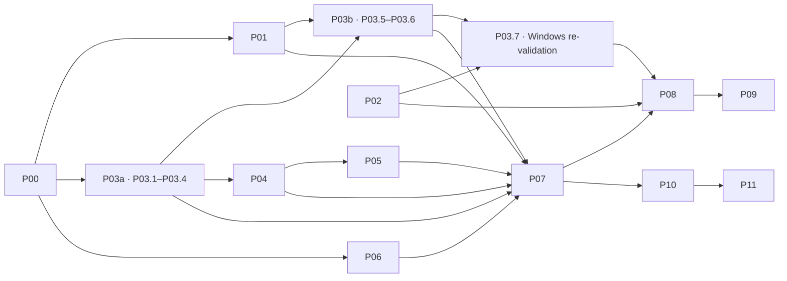

# Desktop Audio Recorder Work Breakdown

**Purpose:** Derives the construction plan into work packages with owners, interfaces, traceability, hosts, and gates, and defines an efficient execution order. **Audience:** Project owner, engineers, and AI agents executing the plan. **Status:** Approved for execution; owner decisions recorded in section 7. Last reviewed: 2026-11-13.

Related documents: [Construction plan](desktop-audio-recorder-construction-plan.md) · [P00 bootstrap plan](desktop-audio-recorder-p00-bootstrap.md) · [Software architecture](../specs/software-architecture-desktop-audio-recorder.md) · [Build specification](../specs/build-specification-desktop-audio-recorder.md) · [Design system](../specs/design-system-desktop-audio-recorder.md) · [Coding practices](../standard/coding-practices-desktop-audio-recorder.md) · [Status](../status.md)

This document does not replace the construction plan. The plan owns phase goals, deliverables, and evidence; the architecture owns contracts; the coding practices own quality gates and commands. This breakdown only splits phases into reviewable work packages (WP) and fixes the order, ownership, and hosts.

## 1. Conventions

| Item | Rule |
| --- | --- |
| WP ID | `Pxx.n`, nested under the plan's task ID. One WP is one branch, one reviewable diff, and one `doc/status.md` checkpoint entry. |
| Host codes | **M** = macOS Apple Silicon bench (this machine). **W** = physical Windows 11 x64. **L** = Ubuntu 24.04 LTS x64 with PipeWire/WirePlumber. **Any** = any host or CI. |
| Gate | Every WP passes the coding practices section 7 checklist and the commands in coding practices section 6 for its scopes. The "Gate" column lists only additional, WP-specific evidence. |
| Step plans | Step-level plans exist only for P00 now. P01, P02, and P10 are hardware spikes whose results reshape later work, so each phase gets its step plan in `doc/plan/` when it starts (`desktop-audio-recorder-pxx-<topic>.md`). |
| Proposed names | Names marked *proposed* are not in the architecture yet. Once accepted, move them into the architecture spec so it stays the single contract source. |

## 2. Repository layout

Paths follow architecture section 1. Additional paths decided here:

| Path | Owner WP | Responsibility |
| --- | --- | --- |
| `rust-toolchain.toml`, `.nvmrc`, `.npmrc` | P00.1 | Pin Rust 1.100.0 and Node 24; `save-exact=true` for npm |
| `Cargo.toml` (workspace) | P00.1 | Members `src-tauri`, `crates/recorder-core`; shared `[workspace.lints]` |
| `scripts/coverage-gate.mjs`, `scripts/coverage-scopes.json` | P00.5 | Coverage gate from coding practices section 6 |
| `.github/workflows/ci.yml` | P00.6 | Lint, typecheck, test, coverage, and build per OS |
| `tests/fixtures/ipc/` | P06.0 | JSON fixtures shared by Rust Serde tests and Vitest |
| `src-tauri/src/ipc/` *(proposed)* | P06.0 | Serde DTOs with `camelCase` fields; maps engine types to IPC |
| `src/ipc/` *(proposed)* | P06.0 | Typed IPC client and TypeScript contract types |
| `src/strings/en-us.ts` *(proposed)* | P06.1 | Single American English string catalog keyed by stable identifiers |
| `native/macos/` | P01.1 | Swift bridge and C header (`recorder_` ABI prefix) |
| `evidence/<wp-id>/` | All | Validation artifacts (ffprobe JSON, logs, screenshots). Audio files are git-ignored; their SHA-256 goes in the evidence note. |

Default decisions (owner may override):

- **Frontend approach:** plain TypeScript modules with Vite, no UI framework. Reason: one window with about ten components, the architecture names no framework, and fewer dependencies keep the package small and the coverage scope simple.
- **Evidence location:** `evidence/` at the repository root, outside the user's recording folders. The summary source matrix lives in `doc/status.md`, so `doc/` stays the knowledge surface and `evidence/` holds raw artifacts.
- **Script names:** hyphenated English names under `scripts/`, run through npm scripts.

## 3. Work packages

### P00 · Bootstrap — host Any (packaging check on M)

Step plan: [P00 bootstrap plan](desktop-audio-recorder-p00-bootstrap.md).

| WP | Deliverable | Produces for later WPs | Gate |
| --- | --- | --- | --- |
| P00.1 | Git repository, toolchain pins, Cargo workspace, empty `recorder-core` crate | Workspace and lint baseline | `cargo fmt`, `cargo clippy` pass |
| P00.2 | Tauri 2 + Vite + TypeScript skeleton without demo code; window and capability baseline | `src/`, `src-tauri/`, app identifier | `npm run tauri dev` opens a 560×600 window titled "Heed" |
| P00.3 | TypeScript lint, format, typecheck, and Vitest coverage setup | npm scripts `lint`, `typecheck`, `test`, `test:coverage` | Commands pass |
| P00.4 | Rust lint policy and `cargo llvm-cov` collection | `coverage/rust.json` | `unsafe_op_in_unsafe_fn` denied; clippy clean |
| P00.5 | Coverage gate script with the four required fixtures | `npm run coverage:gate` | Fixtures: pass, fail at exactly 80%, missing report, missing production file |
| P00.6 | CI workflow for macOS, Windows, Ubuntu | CI job names | Local commands pass; first remote run on GitHub Actions is green |
| P00.7 | Basic packaged window on M | Packaging baseline | `.app` opens; versions and SHA-256 recorded |

### P01 · macOS proof — host M, needs the owner present for permission prompts and playback

| WP | Deliverable | Consumes | Produces | Gate |
| --- | --- | --- | --- | --- |
| P01.1 | Swift bridge skeleton: C header, opaque handle, list/prepare/start/stop, build integration from Cargo | P00.1 | `native/macos/` ABI, XCTest target | XCTest runs; Swift coverage scope becomes active |
| P01.2 | Microphone capture through HAL/AUHAL into a probe binary writing a WAV | P01.1 | Observed formats and timestamps | 60 s decodable WAV; `ffprobe` JSON in evidence |
| P01.3 | Global system tap and aggregate device without muting playback; reverse-order teardown | P01.1 | Tap lifecycle notes | 60 s WAV; playback audible; no leftover aggregate device after stop |
| P01.4 | Simultaneous microphone + system with host-time mapping | P01.2, P01.3 | Clock observations for P03.5 | Two WAVs; start offsets recorded |
| P01.5 | Application tap: process objects, Safari and Chrome helper processes, self-exclusion | P01.3 | macOS rows of the source matrix | Two-tone isolation result per browser and version |
| P01.6 | Permission flow in a signed development build (TCC prompts, denial, revocation) | P01.2–P01.5 | Info.plist keys and entitlement set | Behavior recorded for grant, deny, revoke |

### P02 · Windows proof — host W

| WP | Deliverable | Gate |
| --- | --- | --- |
| P02.1 | WASAPI shared-mode event-driven microphone capture; COM lifecycle on the capture thread | 60 s WAV and observed format |
| P02.2 | Endpoint loopback (`AUDCLNT_STREAMFLAGS_LOOPBACK`), silence, and endpoint switch | Silent-flag and discontinuity counts recorded |
| P02.3 | Process loopback through `ActivateAudioInterfaceAsync`; format negotiation | Second-app exclusion measured |
| P02.4 | Browser process trees (Chrome, Edge, Firefox), helper processes, PID changes | Windows rows of the source matrix |

### P03 · Common engine — host Any

Split into P03a, P03b, and P03.7 as an approved deviation (section 6). Step plan for P03a: [P03a common engine plan](desktop-audio-recorder-p03a-common-engine.md). Owning path: `crates/recorder-core/src/capture/` (contract, synthetic source) and `crates/recorder-core/src/audio/`.

| WP | Part | Deliverable | Contract source | Gate |
| --- | --- | --- | --- | --- |
| P03.1 | a | `AudioBlock`, `CaptureEvent`, source capture trait (prepare/start/stop), format and flag types | Architecture section 2 | Unit tests for invariants |
| P03.2 | a | Synthetic source with injectable clock, silence, discontinuity, drift, and disconnect | Architecture section 2 | Deterministic tests, no sleeps |
| P03.3 | a | Bounded SPSC queue per source sized to about 1 s; overflow counters; library chosen after a no-allocation test | Architecture section 2 | Overflow test counts discarded frames exactly |
| P03.4 | a | PCM conversion to finite `f32`, dBFS, metering (peak, 100 ms RMS, clip, min/max envelope), last-value snapshot | Architecture section 4 | Numerical tests with documented tolerance |
| P03.5 | b | Timeline: frame index to monotonic mapping, drift estimate, gap versus silence versus unknown classification, start-commit origin | Architecture section 4 | Simulated drift and invalid timestamps; RF-14 gap math |
| P03.6 | b | Adaptive resampling with `rubato`, gradual ratio change | Architecture section 4 | Residual drift within 20 ms/h on simulated clocks |
| P03.7 | c | Re-validate the `AudioBlock` contract, timeline, and resampling against the formats, flags, and timestamps observed in P02 | Architecture section 2, P02 evidence | Recorded WASAPI cases replayed through the synthetic source pass |

### P04 · WAV and recovery — host Any (disk-full test on M with a small disk image)

Owning path: `crates/recorder-core/src/storage/`.

| WP | Deliverable | Gate |
| --- | --- | --- |
| P04.1 | Session folder `YYYY-MM-DD_HH-mm-ss_<suffix>`, collision suffix, path validation, destination precheck (256 MiB free, 64 MiB reserve) | Path traversal, symlink, and non-ASCII path tests |
| P04.2 | Versioned `manifest.json` with the architecture section 5 minimum fields; atomic replace | Older schema, missing optional field, and corrupted file tests |
| P04.3 | WAV writer per source: temporary file, 24-bit/48 kHz, 2 s checkpoint with sync and confirmed frame counts, header close, same-directory rename | Header and frame count checked by `ffprobe` |
| P04.4 | Rotation of all masters at 60 min on one sample timeline with `-002` suffixes | Rotation test with a scaled-down limit |
| P04.5 | Recovery: interrupted-session scan, rebuild from complete frames, never overwrite completed masters | Fault injection at every commit step, including between rename and manifest |
| P04.6 | Disk-full and folder-removed handling during writing | Partial segment preserved on a small test volume |

### P05 · Transcription copy — host Any

| WP | Deliverable | Gate |
| --- | --- | --- |
| P05.1 | Pass 1: per-source level in 100 ms windows above −45 dBFS; gain toward −23 dBFS active RMS, capped at +12 dB, unity below 1 s of active audio | Low voice, silence, and pre-clipped fixtures |
| P05.2 | Pass 2 and 3: downmix, anti-aliased 48 kHz to 16 kHz, global peak to −3 dBFS, 16-bit mono write, cancellation detection, resampler state across segments | Phase inversion, two-source, and segment boundary tests |
| P05.3 | Export state (`pending`, `ready`, `failed`), retry, and the speech WER procedure | Synthetic tests in CI; WER run per plan section 3 on the PT-BR and American English corpora |

### P06 · Desktop interface — host Any (screenshots on M first)

| WP | Deliverable | Consumes | Gate |
| --- | --- | --- | --- |
| P06.0 | IPC contract freeze: TypeScript types, Serde DTOs, and shared fixtures for the commands, events, and error codes in architecture section 5 | Architecture section 5 | Same fixtures pass in Rust and Vitest |
| P06.1 | `tokens.css` from design system section 2, layout, light/dark themes, string catalog | P00.3 | Contrast checks on token pairs |
| P06.2 | UI state model as a discriminated union of the nine build-specification states; revision-based stale-event drop; mocked IPC | P06.0 | Every state transition in build specification section 3 tested |
| P06.3 | Source, device, folder (middle truncation), record button, timer, and message region (`aria-live="polite"`) | P06.1, P06.2 | Keyboard order and accessible names tested |
| P06.4 | Waveform canvas and meters: −60 to 0 dBFS, yellow above −6, red at −1, 1 s hold, 2 s saturation, 3 s no-signal, 30 Hz cap, reduced motion | P06.2 | Threshold tests with fake timers |
| P06.5 | Close dialog, result and recovery panels, screenshots in light and dark at 560×600 and 420×480 | P06.3, P06.4 | Screenshot set in evidence |

### P07 · Session integration — host M first, then W and L

| WP | Deliverable | Gate |
| --- | --- | --- |
| P07.1 | Session supervisor in `crates/recorder-core/src/session/`: serialized transitions, generation IDs, idempotent stop, cancel during Starting, dual-source rollback | Double start, repeated stop, and stale event tests on the synthetic source |
| P07.2 | Tauri commands, `recording-state` event, and meter channel; minimal capabilities (`tauri-plugin-dialog` for directories only) | Capability file reviewed; commands validated in Rust |
| P07.3 | Versioned preferences (RF-15) and first-use flow (RF-04, RF-05) | Missing and corrupted preference tests |
| P07.4 | Close flow (RF-12), 3 s disconnection policy (RF-14), recovery offer on open (RF-13) | Kill-and-recover within 5 s on M |
| P07.5 | Vertical slice with the real macOS adapter; offline check of the packaged app | Plan checkpoint "Vertical slice" on M |

### P08 · Application filter — hosts M and W

| WP | Deliverable | Gate |
| --- | --- | --- |
| P08.1 | Process resolution and scope consolidation per OS, using the P01.5 and P02.4 findings | Unit tests on recorded process-tree fixtures |
| P08.2 | Unavailable-mode handling: explicit **System** offer, no silent scope expansion (RF-03) | UI and session tests |
| P08.3 | Browser isolation validation per OS and browser version | AC-02 two-tone results in the source matrix |

### P09 · Release macOS and Windows — hosts M and W

| WP | Deliverable | Gate |
| --- | --- | --- |
| P09.1 | Two-hour dual session, CPU average and p95, memory, drift, and the interruption set | AC-04, AC-05, AC-06, AC-07 measured values |
| P09.2 | Signed NSIS and notarized DMG; traceability to the commit | AC-10; SHA-256 recorded |
| P09.3 | Clean install, permissions in the installed binary, offline flow, accessibility pass | AC-01, AC-03, AC-09 |

### P10 · Linux — host L

| WP | Deliverable | Gate |
| --- | --- | --- |
| P10.1 | PipeWire adapter: registry, input node, sink monitor with `stream.capture.sink`, SPA negotiation | 60 s WAVs from input and monitor |
| P10.2 | Hotplug, reconnect without scope change, Wayland session | Interruption set on L |
| P10.3 | Application streams after isolation proof | Linux rows of the source matrix |
| P10.4 | `.deb` package | Package installs on a clean L host |

### P11 · Linux release — host L

| WP | Deliverable | Gate |
| --- | --- | --- |
| P11.1 | Clean validation, package dependencies, published matrix limits, applicable AC-01 to AC-10 | Release record in `doc/status.md` |

## 4. Requirement traceability

| Requirement | Implemented in | Verified in |
| --- | --- | --- |
| RF-01 Selection | P07.2, P07.3, P06.3 | P07.5, P08.3 |
| RF-02 Browsers | P01.5, P02.4, P08.1 | P08.3 |
| RF-03 Explicit scope | P08.2, P06.3 | P08.3 |
| RF-04 First use | P07.3, P06.3 | P07.5 |
| RF-05 Choose folder | P07.3, P04.1 | P07.5 |
| RF-06 Test level | P03.4, P07.2, P06.4 | P07.5 |
| RF-07 Record | P07.1, P04.1 | P07.5 |
| RF-08 Active recording | P07.1, P06.4, P04.2 | P07.5 |
| RF-09 Stop | P07.1, P04.3 | P07.5 |
| RF-10 Generate copy | P05.1–P05.3 | P07.5 |
| RF-11 Show result | P06.5, P04.2 | P07.5 |
| RF-12 Close window | P07.4, P06.5 | P07.5, P09.3 |
| RF-13 Recover | P04.5, P07.4 | P09.1 |
| RF-14 Handle disconnection | P03.5, P07.4 | P09.1 |
| RF-15 Preferences | P07.3 | P07.5 |
| AC-01 Clean installation and offline use | P09.3, P11.1 | P09.3, P11.1 |
| AC-02 Sources and isolation | P01.5, P02.4, P08.1 | P08.3 |
| AC-03 Permissions and visibility | P01.6, P07.2 | P09.3 |
| AC-04 Long-session integrity | P04.3, P04.4 | P09.1 |
| AC-05 Synchronization | P03.5, P03.6 | P09.1 |
| AC-06 Performance | P03.3, P07.1 | P09.1 |
| AC-07 Failure and recovery | P04.5, P04.6, P07.4 | P09.1 |
| AC-08 Format and speech | P04.3, P05.1–P05.3 | P05.3 |
| AC-09 Accessibility | P06.3, P06.5 | P09.3 |
| AC-10 Distribution | P09.2, P10.4 | P09.2, P11.1 |

## 5. Critical path by available hosts

| Hosts available | Reachable without waiting | First blocker |
| --- | --- | --- |
| M only, plan as written | P00, P01, P06 | P03 waits for P02 (Windows bench), which blocks P04–P07 |
| M only, with the P03 split | P00, P01, P03a, P03b, P04, P05, P06, P07 including the P07.5 macOS vertical slice | P03.7 and P08 need P02; P09 needs W |
| M + W | Everything through P09 | P10 needs L |
| M + W + L | All phases | Signing credentials at P09.2 |

Parallel lanes once P00 is done: **Lane A** P01 (M, hardware, owner present); **Lane B** P03a → P04 → P05 (pure logic); **Lane C** P06.0 → P06 (UI on fixtures); **Lane D** P02 when W exists. The integration owner merges P06.0 before Lane B and Lane C exchange types.

## 6. Approved deviation: split P03

The plan makes P03 depend on P01 and P02. No Windows bench is confirmed, so as written every phase after P01 waits on Windows hardware.

Windows is needed to re-validate the engine, not to build it. Proposal, as a change to the plan's dependency table:

- **P03a** (P03.1–P03.4) depends only on P00. It uses the architecture section 2 contract and the synthetic source.
- **P03b** (P03.5–P03.6) depends on P03a and P01. It uses the formats and host-time behavior observed on macOS plus simulated clocks.
- **P03.7** depends on P03b and P02. It replays the observed WASAPI formats, flags, and timestamps through the engine and must pass before P08.

Risk: a contract change found in P03.7 can ripple into P04 and P07. The contract is platform-neutral and P03.2 can simulate the documented WASAPI flags early, so the expected impact is small. Approved by the owner on 2026-11-13; the construction plan dependency table reflects it.

## 7. Decisions before construction

| # | Decision | Blocks | Outcome (2026-11-13) |
| --- | --- | --- | --- |
| 1 | Product name and app identifier (reverse-DNS). macOS privacy grants are tied to the identifier and signing identity; changing it later resets permissions mid-P01. | P00.2 | **Decided:** product `Heed`, identifier `pro.edgarlima.heed`, window title "Heed". Local desktop project; no DNS reservation. |
| 2 | Git remote and CI host. | P00.6 remote run | **Decided:** public GitHub repository `edgarslima/heed`, CI on GitHub Actions. Branches `main` (stable), `dev` (integration), `initial_dev` (P00). |
| 3 | Availability of the Windows 11 x64 and Ubuntu 24.04 benches. | P02, P10 | **Decided:** Mac only for now. Follow the Mac-only path; P02, P03.7, P08, P09, P10, and P11 stay blocked until benches exist. |
| 4 | Approval of the P03 split into P03a, P03b, and P03.7 (section 6). | P03 start | **Approved.** The construction plan dependency table is updated. |
| 5 | Speech corpus language for the WER test (AC-08). | P05.3 | **Decided:** both PT-BR and American English, scored separately. |
| 6 | Signing credentials: Apple Developer ID and a Windows code-signing certificate. | P09.2 only | **Open.** Not needed before P09. |

## 8. Review focus

Failure modes the specs imply but no requirement states. Each line names the WP that must carry the test.

1. **A second app instance while recording.** Its recovery scan must not treat the live session as interrupted. Proposed: single-instance enforcement plus a session lock file in the session folder. Owner: P04.5 and P07.4.
2. **Quit outside the close button** (Cmd+Q, logout, OS shutdown). It must take the RF-12 finalize path or leave a recoverable session. Owner: P07.4.
3. **A Bluetooth headset microphone that switches the output profile.** Opening the microphone can change the playback route and sample rate mid-session. It must be handled as a format change under RF-14 and never silently change scope. Owner: P01.4 (observe) and P07.4 (handle).
4. **Non-ASCII, long, removable, or network destination paths** (for example, a folder named with accented characters on an external drive that is ejected). Validation, middle truncation, and a partial result are required. Owner: P04.1, P04.6, P06.3.
5. **A wall-clock or timezone change during a session.** Durations come from the monotonic clock; the folder name and `startedAt` come from the start instant only. Owner: P03.5 and P04.2.

## 9. Efficient execution protocol

- Start each WP with the task-start prompt in plan section 4 and end it with a `doc/status.md` checkpoint using the plan's template. Recoverable state stays in the repository; AI Memory holds only short continuity notes.
- One WP per branch or worktree. Commit at each green test step. Review at WP end with the plan's review prompt; run a whole-phase review at each plan checkpoint.
- Delegate pure-logic WPs with fixed interfaces (P03a, P04, P05, P06) to fresh implementers with an independent reviewer per WP. Run hardware spikes (P01, P02, P10) inline with the owner present, because they need permission prompts and audible playback.
- Write each phase's step plan at phase start, from this breakdown plus the evidence of the phases it depends on.
- Re-run only the smallest affected check when switching tools, as the plan requires.
