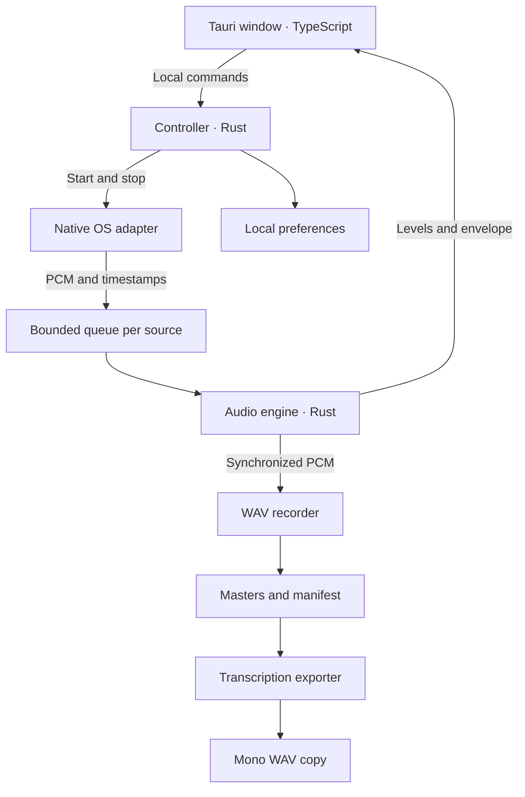

# Software Architecture — Desktop Audio Recorder

**Purpose:** Architecture decisions, capture contract, IPC, storage, and dependencies. **Audience:** Engineers and AI agents implementing or reviewing the app. **Status:** Proposed, revision 1.0. Last reviewed: 2026-11-13.

**Decision.** A Tauri 2 app per platform with a TypeScript frontend and Rust engine in the main process. Native callbacks deliver PCM to bounded queues. The WebView receives commands, state, and aggregated samples for visualization. The packaged app operates locally. [Tauri architecture](https://v2.tauri.app/concept/architecture/)

Revision 1.0 · 11/13/2026. [Build specification](build-specification-desktop-audio-recorder.md) · [Design system](design-system-desktop-audio-recorder.md) · [Construction plan](../plan/desktop-audio-recorder-construction-plan.md)

## 1. Topology and code

| Reference path | Responsibility |
| --- | --- |
| `src/` | TypeScript screen, components, CSS tokens, waveform rendering, and IPC client. Vite for build and development. |
| `src-tauri/src/` | Tauri process, commands, permissions, window, dialogs, and dependency composition. |
| `crates/recorder-core/src/capture/` | Capture contract and implementation for WASAPI, Core Audio, and PipeWire selected by `cfg(target_os)`. The Swift bridge sits in `native/macos/`. |
| `crates/recorder-core/src/audio/` | Buffers, timeline, format conversion, resampling, metering, and mixing. |
| `crates/recorder-core/src/storage/` | Preferences, manifest, WAV, segmentation, export, and recovery. |
| `crates/recorder-core/src/session/` | State machine, cancellation, initialization, and supervision. |
| `doc/` | The project documentation set plus execution state when implementation begins. |

Create the initial Cargo workspace with the Tauri app and a `recorder-core` crate. The boundary avoids engine dependencies on the window or IPC. Internal modules by platform are enough until a real reason emerges to extract crates. Use a single active backend selected at build time, and a synthetic source only for testing. Avoid plugin abstractions, resident services, and network dependencies.

## 2. Capture contract and concurrency

| Data or operation | Contract |
| --- | --- |
| `list_sources` | Returns capabilities by mode, opaque session IDs, names, and default preference. Persisted identity is separate from PID, node ID, or temporary token. |
| `prepare / start` | Resolve permissions, identity, negotiated format, and resources. In dual mode, a failure in the second stream cleans up resources from the first. The session only reports **Recording** after the start commit. |
| `AudioBlock` | `source_id`, sequence, start index in the source clock, frame count, rate, sample format, channel layout, timestamp for the first frame when available, and flags. One frame contains one sample per channel. Samples live in preallocated buffers. |
| `CaptureEvent` | Session events with disconnect, error, format change, discontinuity, or end. The controller receives cause, source, and temporal position when observable. |
| `stop` | Prevents new blocks, waits for in-flight callbacks to finish, and delivers the capture limit. Idempotent. The handle keeps dependencies alive until the producer ends. |

- Each source has one logical producer and one preallocated SPSC queue sized to approximately 1 second of audio based on the negotiated format and worst-case block size. Use a tested ring buffer library after verifying the operation without blocking and without allocation on the critical path. Avoid implementing lock-free structures from scratch.
- Copy PCM into a free slot and return the buffer to the OS inside the callback. Use flags and counters to record overflow. The audio callback performs no I/O, IPC, synchronous logging, block allocation, or mutex wait. Capture work can wait for events outside the callback.
- One audio worker per session coordinates alignment, DSP, and sequential write buffering. Metering feeds a last-value snapshot. If the UI slows down, discard stale snapshots. The PCM queue never crosses the WebView. If writing blocks long enough to fill the queue, account for the loss and report it to the session. Split the writer into a separate worker only if measurements show the need.
- The session uses a supervisor to serialize transitions and validate generation IDs. Canceling **Starting** invalidates the generation, tears down resources, and preserves diagnostic errors. Tauri commands do not trigger async work directly. The main app thread keeps the window responsive.

## 3. Adapter implementation

### Windows · WASAPI

1. Enumerate input and output via MMDevice. Resolve endpoint IDs at start. Watch endpoint invalidation and device changes.
2. Configure the microphone in shared mode. For **System**, use loopback in shared mode with `AUDCLNT_STREAMFLAGS_LOOPBACK` on the selected output endpoint. Use event-driven capture, draining all available packets on each signal.
3. For **Application**, resolve the audio session and process tree. Call `ActivateAudioInterfaceAsync` with process-loopback parameters. Validate format negotiation separately for this backend. Identify browsers by process association and session. Test helper processes and PID changes.
4. Interpret `AUDCLNT_BUFFERFLAGS_SILENT` as zeros without touching invalid content, count `DATA_DISCONTINUITY`, and discard timestamps marked as invalid. Read device position and QPC when valid. Initialize and tear down COM on the same thread that uses it. On disconnect, close the previous client before reopening the same source. [Microsoft — loopback](https://learn.microsoft.com/en-us/windows/win32/coreaudio/loopback-recording) · [Microsoft — process loopback](https://learn.microsoft.com/en-us/samples/microsoft/windows-classic-samples/applicationloopbackaudio-sample/) · [Microsoft — GetBuffer](https://learn.microsoft.com/en-us/windows/win32/api/audioclient/nf-audioclient-iaudiocaptureclient-getbuffer)

### macOS · Core Audio

1. Implement a Swift bridge with a C ABI header, opaque handles, fixed-size C types, and list/prepare/start/stop functions. Declare macOS 14.2 availability and keep the bridge bound to the app. Validate in development and in the signed app.
2. Use HAL/AUHAL for the microphone. For **System**, create a global `CATapDescription` and maintain the playback tap and aggregated device. For **Application**, map audio process objects and browser helper processes. Exclude the recorder itself when applicable.
3. Use the device callback for PCM. Respect the negotiated buffer layout, convert host time to a common monotonic reference, and validate sample-time availability. The callback uses borrowed data only during the call, without transferring buffer ownership. Serialize the lifetime to release the context after confirming that callbacks have stopped. Tear down IOProc, aggregate, and tap in reverse creation order.
4. Configure `NSAudioCaptureUsageDescription`, `NSMicrophoneUsageDescription`, and the required audio input entitlement for Hardened Runtime when required. Trigger permissions after explicit user action. Package with Developer ID and notarization. [Apple — Core Audio taps](https://developer.apple.com/documentation/coreaudio/capturing-system-audio-with-core-audio-taps) · [Apple — AUHAL](https://developer.apple.com/library/archive/technotes/tn2091/_index.html) · [Apple — entitlement](https://developer.apple.com/documentation/bundleresources/entitlements/com.apple.security.device.audio-input) · [Apple — notarization](https://developer.apple.com/documentation/security/notarizing-macos-software-before-distribution)

### Linux · PipeWire

1. Use `pipewire-rs` and `libpipewire` in the user session. Observe the registry and resolve the input or sink monitor target. Define the `stream.capture.sink` for output monitors. Application capture uses identifiable streams and respects WirePlumber policy.
2. Negotiate SPA parameters, validate channel count and layout, offsets, and buffer limits. Copy only valid frames and return buffers immediately. Use stream clock information when available, along with frame counts for continuity.
3. Test on Ubuntu 24.04 LTS x86-64 with Wayland, PipeWire, and WirePlumber. If the target disappears, avoid reconnect policy switching the selection without a clear indicator. Expose **Application** mode after proving isolation without interrupting playback. [PipeWire — streams](https://docs.pipewire.org/page_streams.html) · [PipeWire — monitor sink](https://docs.pipewire.org/page_module_loopback.html) · [WirePlumber — linking](https://pipewire.pages.freedesktop.org/wireplumber/policies/linking.html)

## 4. Clock, DSP, and formats

**Start and duration.** Prepare all streams and establish a common monotonic source at the start commit. Cut or discard frames before the origin. The session ends on a single time limit. A silent stream may need zeroed timeline data when the API does not emit packets while idle. Distinguish this case from discontinuity and loss. Emit the engine duration in frames or milliseconds.

**Alignment.** Maintain the mapping between frame index and host monotonic clock. Capture valid points per source and estimate frequency deviation within a stable window. Apply gradual resampling-ratio changes to avoid jumps. Invalid timestamps use continuity by count within a stable segment with diagnostics. An abrupt change creates a discontinuity. Fill only measurable intervals with silence. Undetermined quantities are flagged in the manifest. The bench measures drift and records fixed latency separately. [Rubato — synchronous and asynchronous resampling](https://github.com/HEnquist/rubato)

| Stage | Input | Output and rule |
| --- | --- | --- |
| Conversion | Integer or float PCM, planar or interleaved | Finite `f32` with known layout. Sanitize invalid samples with diagnostics. |
| Master | `f32` on the common timeline | PCM 24-bit at 48 kHz, mono for microphone and up to two channels for playback. Round and saturate at the integer limit. |
| Metering | `f32` per source | Absolute peak per window, RMS over 100 ms, clipping, and min/max envelope. For stereo, peak is the larger channel and RMS uses average channel energy. |
| Copy for speech | Completed masters | Mono PCM 16-bit at 16 kHz. Use conversion with anti-alias filter. After mix and resampling, measure output peak and apply a fixed attenuation to respect −3 dBFS sample peak. |

For the copy, downmix stereo using L/R when defined. Detect a significant drop in energy from cancellation and flag it for master use. Use up to three read passes with limited memory. In the first pass, measure the level per source in 100 ms windows above −45 dBFS. In the second pass, estimate the global peak of the mix after gain and resampling. In the third, write the copy with the global attenuation already calculated. In dual-source sessions, sum aligned sources with separate gains and headroom before quantization. The master remains free of AGC and voice enhancement. Use fixed source gain with an initial active RMS target of −23 dBFS and a ceiling of +12 dB. If there are fewer than 1 second of active windows, apply unity gain before the peak adjustment. In writing, repeat the deterministic pipeline and apply the measured global attenuation. Keep the resampler state between contiguous segments to preserve continuity. [OBS — input decisions](https://obsproject.com/kb/audio-mixer-guide)

## 5. Session, IPC, and storage

| IPC proposed | Input | Response |
| --- | --- | --- |
| `get_state` | None | State, monotonic revision, current session, modes, settings, and current errors |
| `list_sources` | Mode | Available sources with opaque IDs and capabilities |
| `choose_output_directory` | None | Native dialog result and updated configuration |
| `set_preferences` | Mode, allowed IDs, copy option | Validated preferences and updated state |
| `start_preview` / `stop_preview` | Selected configuration or active ID | Current state |
| `start_recording` / `stop_recording` | Selected configuration or active ID | Accepted state. Events confirm transitions and completion |
| `open_recording_folder` / `export_transcription` / `recover_recording` | Known session ID | Result or operation state |
| `subscribe_meter` | Channel IPC and current session | Snapshots up to 30 Hz with revision, time, RMS, peak, and reduced envelope |
| `recording-state` | Event emitted by Rust | State change, revision, and session. On reload, query `get_state`. |

Use Serde-serializable structs with `camelCase` fields on the IPC layer. Keep matching TypeScript types and fixtures that verify compatibility. Errors include code, message, origin, and retry indication. Initial codes: `permissionDenied`, `sourceUnavailable`, `diskFull`, `outputUnavailable`, `formatUnsupported`, `captureInterrupted`, and `exportFailed`. The backend resolves paths and session IDs. The window uses only local assets and minimum dialog and folder-opening capabilities. Subscribe to the channel only in the main window and drop stale revisions. [Tauri — Rust commands](https://v2.tauri.app/develop/calling-rust/) · [Tauri — channels](https://v2.tauri.app/develop/calling-frontend/) · [Tauri — capabilities](https://v2.tauri.app/security/capabilities/)

### Files, checkpoints, and recovery

1. Create a dedicated folder inside the validated destination and save the manifest in `recording` state before enabling writes. Colliding destinations generate a new suffix. Artifact paths are relative to the session directory. The app restricts operations to the known session and treats invalid links and paths as errors.
2. Write WAV files to temporary files with known headers and integer data. The proposed checkpoint is every 2 seconds. Synchronize each master, record frame counts confirmed by the writer, and replace the manifest with an atomic operation compatible with the OS. Verify folder durability when the platform supports it and measure the cost. The target recovery window is 5 seconds for process termination under test conditions; it is not a guarantee under electrical failure.
3. Rotate all masters on the same 60-minute limit. Register segments individually with index, `startFrame48k`, `frameCount`, format, and file name. If a source ends before the limit because of failure, record the missing interval and the observable interruption in the session.
4. On stop, drain to the session limit, adjust the header, sync, close, and rename each master. Record completion in the manifest. Publish `saved` or `partial` after updating. The transcription copy uses a temporary file and a separate state of `pending`, `ready`, or `failed`.
5. On recovery, consider the manifest and real files. Handle the case where the process died between renaming a master and confirming the manifest. Validate headers and sizes. Read complete safe frames, limit by the manifest when ambiguous, and reconstruct the WAV into a recovered file. Never overwrite a completed master. Close an incomplete copy separately. [Hound — WAV writing and finalization](https://docs.rs/hound/latest/hound/struct.WavWriter.html)

Minimum manifest fields: `schemaVersion`, `sessionId`, `startedAt` with timezone, `captureStatus`, `exportStatus`, `sources` with category and input/output formats, `segments`, `gaps`, `checkpoint`, and `recovered`. Store gap intervals with frame position and length or mark unknown extension. Local logs contain codes and counts only. Full paths, audio data, and session content stay out of routine logs. No telemetry is enabled in the MVP.

## 6. Dependencies and deployment decisions

| Area | Decision |
| --- | --- |
| Tools | Node LTS compatible with Vite and Tauri, npm with lockfile, stable Rust version pinned by the project, Cargo.lock, and platform SDKs |
| DSP and file | `rubato` for resampling, `hound` for WAV, and Serde for JSON. Validate the writer checkpoint in a spike. Select the queue library after audio-callback testing. |
| Frontend | Tauri 2, TypeScript, Canvas, and CSS. `tauri-plugin-dialog` for directories. Open the folder only through a known result. |
| Windows | Windows 11 x64, MSVC, Windows SDK, WebView2, and NSIS. Release package is signed. |
| macOS | Apple Silicon, macOS 14.2+, Xcode, WKWebView, Developer ID signature, Hardened Runtime, and notarized DMG. |
| Linux | Ubuntu 24.04 LTS x64 as the first target, WebKitGTK, PipeWire, WirePlumber, and Debian package. |
| Testing | Synthetic source, PCM fixtures, and `ffprobe` in development and CI. Native validation on hardware. |

Build per operating system with local frontend assets and only the adapter for the active target. Release validation must confirm permissions in the final binary and open without network after installation. Preserve traceability between the executable and the code revision. [Tauri — prerequisites](https://v2.tauri.app/start/prerequisites/) · [Tauri — distribution](https://v2.tauri.app/distribute/) · [Tauri — Debian package](https://v2.tauri.app/distribute/debian/)
